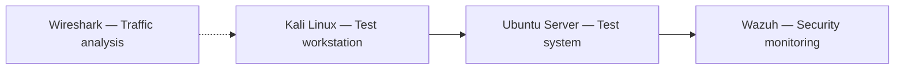

# Cybersecurity SOC Lab

A personal, isolated lab for practicing Linux security monitoring, network investigation, and SOC workflows. I built and operated the environment to study how activity on a test system is observed and investigated. This repository documents the setup and the evidence still needed to make it reproducible.

## Lab at a glance

| Component | Role |
| --- | --- |
| VirtualBox | Local virtualized environment |
| Kali Linux | Security testing workstation |
| Ubuntu Server | Test system |
| Wazuh | Security event collection and analysis |
| Wireshark | Packet inspection |
| Nmap | Network discovery in the authorized lab |

### Logical layout

This is a **logical component diagram**, not a record of my exact network addressing, virtual switches, or sensor configuration. Those details are not yet published.

## What I worked on

- Provisioned Linux virtual machines for an isolated training environment.
- Used Wazuh to monitor test-system events and review security logs.
- Performed controlled security exercises and examined their observable output.
- Used network tools to investigate connectivity and traffic during lab work.

These are **personal lab activities**, not production SOC employment or customer incident response.

## Reproducing and validating the environment

The original VM images, Wazuh configuration, exercise commands, alert exports, and screenshots are **not included in this repository**. As a result, this README is a project record, not a one-command lab installer or independent proof of every exercise.

The [validation worksheet](docs/VALIDATION.md) is a checklist for recording a fresh, reproducible run. A reviewer should be able to see the test objective, the expected telemetry, the actual observed alert or log record, and the interpretation of that evidence. Do not substitute fabricated screenshots or synthetic results for evidence from the actual lab.

## Safety and data handling

Run exercises only on systems you own or are authorized to test. Keep the virtual network separated from production systems. Before publishing any logs, configurations or packet captures, remove secrets, tokens, addresses, usernames and other identifying information. VM disks and raw captures are intentionally excluded from version control.

## Next steps

- [ ] Publish a sanitized topology with verified virtual-network settings.
- [ ] Document one repeatable event-to-alert investigation with evidence.
- [ ] Add minimal configuration samples after checking them for sensitive values.
- [ ] Record actual pass/fail observations in the validation worksheet.

**Project status:** Lab built and operated personally; public, reproducible evidence is being prepared.